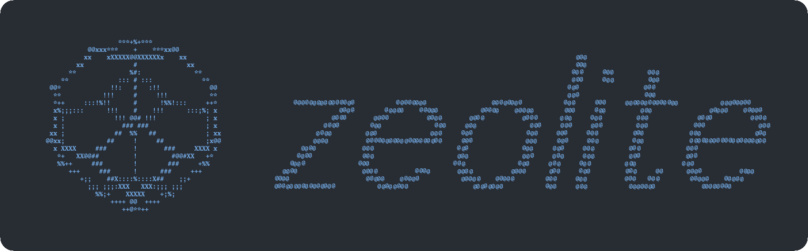

# zeolite

A macOS app that keeps AI agents in Docker sandboxes and shows them all in one window. It is for three things:

1. **A sealed sandbox.** Each sandbox is a Linux container with a home of its own. It holds none of this Mac's files, learns nothing of this Mac's network and reaches nothing on it. What it has beyond that, you gave it: a [Shared Folder](docs/shared-folders.md) on this Mac, and [Capability Packs](docs/capability-packs.md) such as a browser that you and the agent both use: you in the window and the agent through MCP.
2. **The interface and the exit address you choose.** A sandbox leaves this Mac by the interfaces you allow it (Wi-Fi, Ethernet, a tunnel) and only while a probe sees it at an exit address you expect there. Seen anywhere else, or not seen at all, its gate locks and nothing leaves. See [how the gate holds, and what it does not promise](docs/gate.md).
3. **Host Tools behind a wall.** Where you allow it, a sandbox's agent runs programs of this Mac, with its GPU if you say so. What can work without a screen or a network runs, from compilers and app frameworks to ffmpeg, Blender and game engines: the system's own and Homebrew's with no list to keep, and of `/Applications` what you name. Each runs under a Seatbelt profile that lets it read that software and write the sandbox's Shared Folder, and nothing else: no file of yours, no network, no other program. See [Host Tools](docs/host-tools.md).

You install agents yourself, in a sandbox's terminal, and start them there by typing, or from an ACP client on this Mac, such as an editor, through the sandbox's ACP Bridge. [The window](docs/window.md) shows each sandbox's state at a glance, and puts first the ones that need you.

## Setup

You need macOS 13 or later, [Go](https://go.dev/dl/) 1.27.4 or later (an older Go, from 1.21 on, downloads it by itself), Xcode's command line tools and [Colima](https://colima.run). Sandboxes run in a Colima profile of their own, a VM that mounts one folder of this Mac: the root of the Shared Folders.

```sh
brew install colima
mkdir -p -m 700 /Users/Shared/zeolite/shared.noindex
colima start --profile zeolite --cpu 4 --memory 8 --disk 40 --vm-type vz --activate=false \
  --mount /Users/Shared/zeolite/shared.noindex:w
```

Then:

```sh
go generate ./...                     # builds the in-container binaries, the Carrier and the GPU Shim, and draws the icon and the Masthead; needed before anything else compiles
go tool mygo dev                      # run the app
go tool mygo build                    # package build/darwin-arm64/zeolite.app
```

The first start of a sandbox builds its images in the VM, which takes a few minutes.

## More

- [The gate](docs/gate.md): what a sandbox reaches, how the gate holds, and its limits.
- [The window](docs/window.md): Cards, Panes, Agent Sessions and the Setup.
- [Capability Packs](docs/capability-packs.md), [Shared Folders](docs/shared-folders.md), [Host Tools](docs/host-tools.md) and the [ACP Bridge](docs/acp-bridge.md).
- [Layout](docs/layout.md): the code, and where the app keeps things on this Mac.
- [Tests](docs/tests.md): how to run them, what was checked and what was not.
- [GLOSSARY.md](GLOSSARY.md): the words used here and in the app.
